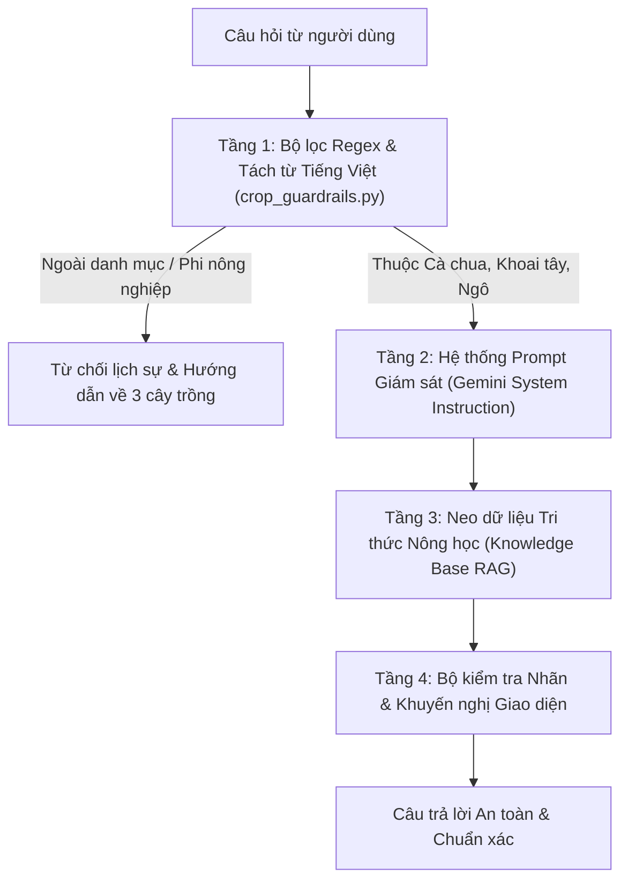

# BỘ QUY TẮC HẠN CHẾ PHẠM VI TƯ VẤN NÔNG NGHIỆP (CHATBOT SCOPE GUARDRAILS)
**Dự án:** Hệ thống Tư vấn Bệnh Cây trồng AI - Samsung Innovation Campus (SIC) Group 5  
**Phiên bản quy chuẩn:** v1.0.0 (Bio-Security & AI Agricultural Safety Policy)

---

## 1. Mục đích và Ý nghĩa Khoa học

Trong các ứng dụng trí tuệ nhân tạo phục vụ sản xuất nông nghiệp, việc **kê đơn thuốc bảo vệ thực vật (BVTV), hướng dẫn liều lượng pha chế và tư vấn xử lý thổ nhưỡng** đòi hỏi độ chính xác và tính an toàn sinh học tuyệt đối. 

Nếu một mô hình AI được huấn luyện trên 3 cây trồng (Cà chua, Khoai tây, Ngô) nhưng lại tùy tiện trả lời các câu hỏi về Lúa, Sầu riêng, Bưởi, Cam, Chanh..., hệ thống có thể gây ra những hậu quả nghiêm trọng:
1. **Hiện tượng Ngộ độc Cây trồng (Phytotoxicity):** Mỗi loài thực vật có biểu bì lá, ngưỡng mẫn cảm với hoạt chất hóa học và độ chịu mặn/chịu axít khác nhau. Áp dụng thuốc của cà chua sang sầu riêng hoặc lúa có thể làm cháy lá non, rụng hoa và rụng quả hàng loạt.
2. **Kháng thuốc & Tồn dư Hóa chất (MRL Violations):** Dùng sai hoạt chất hoặc sai liều lượng khiến dịch hại kháng thuốc và dư lượng hóa chất vượt ngưỡng cho phép, gây mất an toàn vệ sinh thực phẩm.
3. **Ảo giác Mô hình (AI Hallucination):** Các mô hình ngôn ngữ lớn (LLM) nếu không có bộ lọc quy tắc (Guardrails) có thể bịa đặt phác đồ thuốc chưa được khảo nghiệm lâm sàng.

Do đó, **Bộ Quy tắc Phạm vi (Scope Guardrails)** này được thiết lập nhằm giới hạn chặt chẽ phạm vi hoạt động của Trợ lý Chatbot AI, chỉ trả lời **đúng 3 loại cây trồng chính đã được huấn luyện và thẩm định dữ liệu**.

---

## 2. Danh mục 3 Cây trồng Được phép Hỗ trợ (In-Scope Crops)

Chatbot được cấp quyền trả lời chuyên sâu toàn diện (chẩn đoán, phân tích đất trồng, sâu hại môi giới, liều lượng thuốc BVTV, thời gian cách ly PHI) cho duy nhất 3 cây trồng sau:

| STT | Cây trồng | Tên tiếng Anh | Tên khoa học | Họ thực vật | Các bệnh mục tiêu được huấn luyện |
| :---: | :--- | :--- | :--- | :--- | :--- |
| **1** | **Cà chua** | Tomato | *Solanum lycopersicum* | Solanaceae (Họ Cà) | • Mốc sương / Sương mai (*Phytophthora infestans*) • Đốm vòng / Cháy lá sớm (*Alternaria solani*) • Đốm lá Septoria (*Septoria lycopersici*) • Cây khỏe mạnh |
| **2** | **Khoai tây** | Potato | *Solanum tuberosum* | Solanaceae (Họ Cà) | • Sương mai tàn lụi (*Phytophthora infestans*) • Đốm vòng sớm (*Alternaria solani*) • Cây khỏe mạnh |
| **3** | **Ngô (Bắp)** | Corn / Maize | *Zea mays* | Poaceae (Họ Hòa thảo) | • Bệnh gỉ sắt (*Puccinia sorghi*) • Bệnh cháy lá hình thoi lớn (*Exserohilum turcicum*) • Bệnh đốm xám chữ nhật (*Cercospora zeae-maydis*) • Cây khỏe mạnh |

---

## 3. Quy chuẩn Xử lý Cây trồng Ngoài Phạm vi (Out-of-Scope Crops)

### 3.1. Danh mục Nhận diện Từ chối Chủ động
Hệ thống tự động phát hiện và chặn các câu hỏi về:
* **Cây lương thực & công nghiệp khác:** Lúa nước, Cà phê, Hồ tiêu, Chè (trà), Cao su, Điều, Mía, Khoai lang, Sắn (khoai mì)...
* **Cây ăn trái nhiệt đới:** Sầu riêng, Cây có múi (Cam, Bưởi, Chanh, Quýt), Thanh long, Xoài, Nhãn, Vải, Chuối, Đu đủ, Ổi, Nho, Táo, Bơ, Mít...
* **Rau củ quả khác:** Dưa hấu, Dưa leo (dưa chuột), Dưa lưới, Bí đao, Bí đỏ, Bầu, Mướp, Ớt, Cà tím, Hành, Tỏi, Bắp cải, Su hào, Súp lơ, Cải ngọt, Cải xanh...
* **Hoa cây cảnh:** Hoa hồng, Hoa lan, Hoa cúc...

### 3.2. Cơ chế Phản hồi Chuẩn mực khi Bị từ chối
Khi phát hiện cây trồng ngoài danh mục, Chatbot kích hoạt phản hồi chuẩn mực theo 3 phần:
1. **Thông báo từ chối dứt khoát:** Nêu rõ tên cây trồng vừa hỏi và khẳng định nằm ngoài phạm vi 3 cây trồng được huấn luyện.
2. **Giải thích lý do an toàn sinh học:** Nêu rõ nguy cơ ngộ độc cây trồng, cháy lá và dư lượng thuốc BVTV khi áp dụng phác đồ chưa qua kiểm nghiệm.
3. **Hướng dẫn bà con giải pháp thay thế:**
   - Liên hệ trực tiếp Cán bộ Khuyến nông hoặc Trạm Trồng trọt & BVTV địa phương.
   - Nhắc nhở danh mục 3 cây trồng (Cà chua, Khoai tây, Ngô) mà hệ thống hỗ trợ tốt nhất.

---

## 4. Kiến trúc Thực thi 4 Tầng (4-Layer Guardrail Enforcement)

1. **Tầng 1 (Deterministic Python Filter - `backend/crop_guardrails.py`):**
   - Chuẩn hóa văn bản loại bỏ dấu (`strip_accents`) và kiểm tra đối sánh ranh giới từ (`word boundary regex`).
   - Chặn ngay tại gateway mà không tiêu tốn token API hay gây trễ suy luận.
2. **Tầng 2 (Prompt Guardrails trong Google Gemini):**
   - Đưa chỉ thị ràng buộc cứng (`systemInstruction`) vào payload của mô hình `gemini-3.1-flash-lite`.
   - Ngăn chặn triệt để kỹ thuật tấn công bẻ khóa prompt (Jailbreak / Persona Prompt Injection) cố tình ép AI tư vấn cây khác.
3. **Tầng 3 (Local Knowledge Base Grounding):**
   - File `data/advisory_knowledge_base.json` chỉ chứa hồ sơ sâu bệnh, thổ nhưỡng và thuốc cho 11 lớp thuộc Cà chua, Khoai tây, Ngô.
4. **Tầng 4 (Giao diện Người dùng):**
   - Hiển thị badge màu tím: `🛡️ Giới hạn an toàn: Chỉ 3 cây trồng (Cà chua, Khoai tây, Ngô)` và thông điệp chào mừng nêu rõ phạm vi ngay từ đầu.

---

## 5. Kết quả Kiểm thử Nghiệm thu

Bộ kiểm thử đơn vị tự động tại [`tests/test_crop_guardrails.py`](file:///d:/AI_SIC_ICTU_2026/Final_SIC_AI_2026/Project/SIC/tests/test_crop_guardrails.py) đã xác nhận **11/11 trường hợp kiểm thử đạt 100% PASS**:

- `test_supported_tomato_in_scope`: Cà chua -> **Hợp lệ (In-Scope)**.
- `test_supported_potato_in_scope`: Khoai tây -> **Hợp lệ (In-Scope)**.
- `test_supported_corn_in_scope`: Ngô -> **Hợp lệ (In-Scope)**.
- `test_supported_disease_without_explicit_crop_in_scope`: Bệnh mốc sương / gỉ sắt -> **Hợp lệ (In-Scope)**.
- `test_out_of_scope_rice_rejected`: Cây lúa -> **Từ chối (Out-of-Scope)**.
- `test_out_of_scope_durian_rejected`: Sầu riêng -> **Từ chối (Out-of-Scope)**.
- `test_out_of_scope_citrus_rejected`: Bưởi / Cam -> **Từ chối (Out-of-Scope)**.
- `test_out_of_scope_watermelon_rejected`: Dưa hấu -> **Từ chối (Out-of-Scope)**.
- `test_non_agricultural_rejected`: Lập trình Python / Giải toán -> **Từ chối (Out-of-Scope)**.
- `test_chatbot_refusal_response_via_chat_engine`: Phản hồi chứa đầy đủ lời khuyên an toàn khuyến nông.
- `test_chatbot_api_endpoint_rejects_out_of_scope`: Endpoint `/api/chat` xử lý đồng bộ và an toàn.
