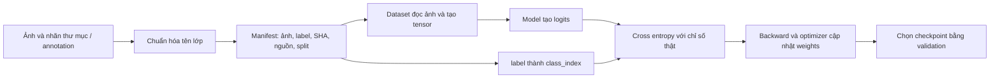

# Nhãn ảnh được lưu và sử dụng như thế nào?

Project dùng supervised learning: mỗi ảnh train đã có nhãn mục tiêu. Nhãn hiện tại chủ yếu từ dữ liệu công khai, được code chuẩn hóa tên; chưa phải bộ ảnh do nhóm tự thu và được chuyên gia duyệt đầy đủ.

## Từ ảnh có nhãn đến weights



Ví dụ thật:

```text
Thư mục: Corn_(maize)___Cercospora_leaf_spot Gray_leaf_spot
Label:   Corn_Gray_leaf_spot
Index:   1
Split:   train
```

Ánh xạ ở `ml/labels.py`. `ml/prepare_dataset.py` đọc nhãn thư mục, kiểm ảnh/hash/nhóm lá rồi tạo CSV. `data/processed/plantvillage/train.csv` có `label` và `class_index`; `ml/dataset.py` kiểm thứ tự lớp và đọc chúng.

`ml/prepare_field_v2.py` kết hợp các nguồn đã chọn và crop từ annotation train. Nhãn crop kế thừa annotation/ảnh cha; crop không tự tạo nhãn bệnh mới. `data/processed/field_mobile_v2/records.json` lưu từng ảnh cùng nhãn chuẩn.

`FieldDataset.__getitem__` trong `ml/train_field.py` kiểm SHA, xử lý RGB/EXIF, letterbox 224 × 224 và chuẩn hóa, rồi trả:

```python
tensor, FIELD_CLASSES.index(row['label'])
```

V2 dùng chỉ số 0–10; V3 thêm `Unsupported` ở 11. `ml/continue_field.py` tính cross-entropy giữa logits và nhãn thật, gọi backward/AdamW trên CUDA. Khi người dùng gửi ảnh suy luận, không có nhãn mục tiêu được truyền vào model.

## Xem nhãn thật

```powershell
.venv/Scripts/python.exe -m ml.inspect_labels --output artifacts/label_review/review_new.csv
```

CSV xuất đủ 20.902 record. `current.preview.csv` lấy một ví dụ mỗi lớp; summary JSON ghi class map, số lượng theo split/lớp và SHA manifest. [Bản trích từ record thật](benchmarks/label_preview.csv).

| Cột | Ý nghĩa |
|---|---|
| path / sha256 | Ảnh và hash dự kiến |
| label / class_index | Nhãn mục tiêu trainer đọc |
| source_dataset / domain | Nguồn và nhóm domain |
| split | Chỉ train cập nhật weights |
| original_label | Chuỗi gốc nếu record có lưu; trống khi thiếu, không tự suy diễn |
| label_status | Phạm vi duyệt; nhãn thư mục chưa phải chứng nhận chuyên gia |
| proposed_label / reviewer / review_notes | Cột trống để người có chuyên môn đề xuất sửa |

## Ảnh mới do nhóm tự thu

Lưu ảnh gốc, loài cây, mã cây/lá và phiên chụp. Người duyệt chọn bệnh hoặc đánh dấu cần xem lại/ngoài phạm vi/nhiều bệnh, ghi căn cứ và tên người duyệt. Không tự đổi ảnh chưa biết bệnh thành healthy hoặc Unsupported.

CSV review là bản xuất chỉ đọc. Sửa các cột đề xuất chưa tự sửa manifest hay train lại. Sau khi duyệt, cần tạo phiên bản dữ liệu mới, nhóm cùng lá/phiên chụp, lọc trùng rồi khóa split. Không chỉnh holdout để nâng điểm model đã xem kết quả. Hiện chưa có UI gán nhãn thủ công hoặc quy trình chuyên gia hoàn chỉnh.

Detection cần hộp bao lá; segmentation cần mask pixel. Nhãn phân loại không cung cấp vị trí tổn thương, nên classifier hiện tại không tự tìm vùng crop. Holeta đã nằm train của candidate đa nguồn, không phải external test độc lập cho candidate này.
