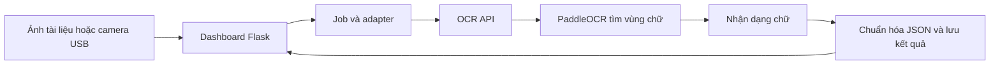
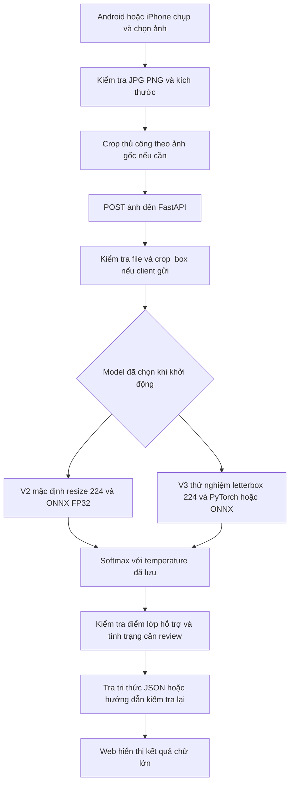

# Học pipeline ViLLite và áp dụng cho SIC

ViLLite là hệ thống OCR tài liệu tiếng Việt, còn SIC phân loại tình trạng lá cây. Phần đã áp dụng trong lượt này là cách tách model khỏi giao diện, giữ hợp đồng dữ liệu rõ ràng, export runtime CPU và đo lại toàn tuyến API. SIC tiếp tục dùng FastAPI và các model bệnh lá hiện có.

Nguồn được chốt tại [ViLLite commit 09e2691320429a32e7f3ea9e0fb701d45139fdf2](https://github.com/cyberbount/ViLLite/tree/09e2691320429a32e7f3ea9e0fb701d45139fdf2). [Bài đọc mã nguồn đầy đủ](../../research/VILLITE_SOURCE_REVIEW.md) phân biệt README, code đang gọi và phần nghiên cứu chưa triển khai. Không cài môi trường hoặc chạy weights OCR trong lượt này.

## Pipeline ViLLite thực tế



API web tạo một PaddleOCR có detection và recognition. Các cờ hiệu chỉnh hướng tài liệu và unwarping đều tắt trong entry point này. ONNX nằm ở các công cụ thí nghiệm riêng, chưa phải backend của API web ViLLite. [API](https://github.com/cyberbount/ViLLite/blob/09e2691320429a32e7f3ea9e0fb701d45139fdf2/ocr_api.py#L23-L39), [adapter](https://github.com/cyberbount/ViLLite/blob/09e2691320429a32e7f3ea9e0fb701d45139fdf2/src/pipeline/run_pipeline.py#L150-L212).

## Pipeline SIC phù hợp hiện tại



Một yêu cầu chạy một model đã chọn, không nối V2 với V3. Crop trên web tạo JPEG mới để preview và gửi đúng cùng bytes; client khác có thể dùng crop_box ở API. Không áp dụng cả hai đường crop cho cùng thao tác web. Chưa có model tự tìm hoặc phân đoạn lá.

Model chạy trên server CPU. ONNX ở đây không có nghĩa điện thoại tự chạy model hoặc đã hỗ trợ offline. Camera điện thoại vẫn do trình duyệt/ứng dụng camera của điện thoại cung cấp; CameraService V4L2/USB trên server của ViLLite không thay được luồng này.

## Những phần học được và cách chọn

| Ý trong ViLLite | Cách dùng cho SIC | Trạng thái |
|---|---|---|
| Detector tìm vùng chữ rồi recognizer | Dùng làm mẫu tổ chức detector lá rồi classifier, khi có nhãn hộp/mặt nạ lá | Đề xuất, chưa triển khai |
| Crop từ tọa độ annotation trên ảnh gốc, chặn biên | Giữ nguyên tọa độ ảnh nguồn và quy tắc crop đã kiểm tra; không warp lá thành khung chữ | SIC đã có crop thủ công |
| Tách adapter và OCR API | Giữ inference/advisory tách trong cùng FastAPI, một origin cho web | SIC đã có, chưa cần thêm hai Flask service |
| ONNX FP32/INT8 và benchmark CPU | Export V3 FP32, kiểm tra parity toàn validation rồi đo HTTP riêng | Đã bổ sung và đo |
| Health và tải weights có checksum | Giữ readiness từ model thật; graph kiểm tra checkpoint hash, labels, preprocessing và temperature | Đã bổ sung cho graph V3 |
| Train, Eval, unseen riêng | Khóa bộ điện thoại mới theo cây/lần chụp; không chọn tiếp trên test cũ | Cần dữ liệu và nhãn mới |
| Job queue và history cho OCR dài | Giữ request ngắn và giới hạn hai inference đồng thời; chưa thêm queue/history | Quy mô hiện tại phù hợp |

ViLLite crop tứ giác cho chữ, dùng kích thước recognizer 48×320 hoặc 48×800 và loss chuỗi. Các phần đó không phù hợp trực tiếp với bệnh lá. Tọa độ đúng vẫn cần giữ đủ triệu chứng; một vùng crop đẹp chưa chứng minh phân loại tốt hơn. [Converter crop](https://github.com/cyberbount/ViLLite/blob/09e2691320429a32e7f3ea9e0fb701d45139fdf2/src/dataset/convert_vintext_rec.py#L41-L87).

Các script ONNX ViLLite cũng dùng những hợp đồng preprocessing khác nhau, nên cần đối chiếu với artifact thực tế. Cờ tắt MKL-DNN trong Paddle không được chuyển sang PyTorch một cách máy móc. SIC dùng chung một hàm decode/letterbox/normalize cho cả hai runtime. [API Paddle](https://github.com/cyberbount/ViLLite/blob/09e2691320429a32e7f3ea9e0fb701d45139fdf2/ocr_api.py#L1-L8), [test preprocessing](https://github.com/cyberbount/ViLLite/blob/09e2691320429a32e7f3ea9e0fb701d45139fdf2/tools/test_onnx_rec.py#L9-L44).

## Phần đã thực hiện trong code SIC

`ml.export_field_onnx` export V3 FP32 với batch động và giữ thứ tự 12 đầu ra. Metadata graph ghi kiến trúc, input 3×224×224, preprocessing, mean/std, temperature, trạng thái calibration và SHA-256 checkpoint. Export từ chối ghi đè graph đã có.

`FieldInferenceEngine` chỉ dùng ONNX khi có đường dẫn được chỉ định. Engine kiểm tra metadata, input/output và hash checkpoint; graph khác checkpoint khiến model không ready, không âm thầm dùng trọng số khác. Mặc định V2 và mặc định V3 eager giữ nguyên. Chưa export hoặc chọn INT8 V3.

`ml.validate_field_runtime` đọc riêng validation và so logits, xác suất, nhãn, cổng điểm giữa PyTorch/ONNX trên cùng tensor. `ml.api_benchmark` có tùy chọn V3, kiểm tra runtime mà health thực sự báo, tách môi trường các lượt và ghi đúng hash weights. Điều này tránh việc môi trường V3 làm số benchmark bị gắn nhãn V2 hoặc runtime khác.

Không có lượt train mới, không đổi weights, label, temperature hoặc tiêu chí kiểm định bệnh lá trong thí nghiệm runtime này.

## Kết quả đo ngày 03/11/2026

[Đối chứng runtime](runtime_validation.json) dùng 2.145 ảnh validation: 1.731 PlantVillage và 414 PlantDoc. Không đọc test.

| Kiểm tra | Kết quả |
|---|---:|
| Nhãn khác PyTorch | 0 / 2.145 |
| Quyết định vượt cổng điểm khác | 0 |
| Sai lệch xác suất tối đa | 0,00001323 |
| Ngưỡng sai lệch đặt cho runtime | 0,0001 |
| F1 PlantVillage của cả hai runtime | 97,52% |
| F1 PlantDoc các lớp trong phạm vi có mẫu | 46,59% |

Số F1 không tăng do đổi ONNX. Cổng kiểm định bệnh lá vẫn không đạt như [lượt trước](../mobile_field/continuation_20261103/README.md).

[Benchmark HTTP chính](http_benchmark.json) chạy sau regression, hai CPU thread, hai inference slot, 11 ảnh validation (một ảnh mỗi lớp), 5 warmup rồi 40 yêu cầu ở mỗi mức tải. Phép đo gồm multipart upload, validation, preprocessing, model, tra JSON và response localhost.

| Runtime V3 | Client đồng thời | Mean HTTP ms | p95 HTTP ms |
|---|---:|---:|---:|
| PyTorch eager | 1 | 34,16 | 69,61 |
| ONNX FP32 | 1 | 18,11 | 35,97 |
| PyTorch eager | 4 | 71,54 | 86,79 |
| ONNX FP32 | 4 | 34,92 | 39,26 |

Đây là một thí nghiệm trên máy Windows hiện tại, không phải độ trễ Internet hoặc điện thoại thật. Chưa đo ARM, RAM peak hay tải mở dài hạn. Lượt đầu [chạy trùng regression](http_smoke_during_regression.json) chỉ giữ làm smoke test; không dùng số đó làm kết luận hiệu năng.

Đo in-process riêng dùng 4 JPEG demo và 40 lần tuần tự sau 8 warmup. Mean PyTorch/ONNX lần lượt 26,50/9,93 ms; p95 61,18/12,78 ms. Phạm vi và ảnh khác benchmark HTTP, nên không lấy hiệu hai số để suy ra chi phí mạng hoặc API. Benchmark ViLLite chỉ đo `session.run` một ảnh; FPS đó không phải throughput API. [Script ViLLite](https://github.com/cyberbount/ViLLite/blob/09e2691320429a32e7f3ea9e0fb701d45139fdf2/tools/benchmark_onnx_rec.py#L6-L53).

## Cách chạy trên máy hiện tại

Nếu đã có graph đã kiểm tra trong gói bàn giao:

```powershell
.\run_field_demo.cmd onnx
```

Dừng server cũ ở port 8003 trước khi dùng cùng port. Mở `http://127.0.0.1:8003/app`, kiểm tra `/api/health` báo `inference_runtime: onnx`. Đây vẫn là V3 thử nghiệm, chưa phải bản được chọn để triển khai thực địa.

Để tái tạo, cài dependencies của SIC, không chạy Bash launcher hoặc cài PaddleOCR từ ViLLite:

```powershell
.\.venv\Scripts\python.exe -m pip install -r requirements-onnx.txt
.\.venv\Scripts\python.exe -m ml.export_field_onnx --output models/field_new.onnx
.\.venv\Scripts\python.exe -m ml.validate_field_runtime --onnx models/field_new.onnx --output artifacts/field_new_parity.json
.\.venv\Scripts\python.exe -m ml.api_benchmark --field-weights models/mobilenetv3_field_continued_20261103.pt --field-onnx models/field_new.onnx --runtimes eager onnx --threads 2 --slots 2 --concurrency 1 4 --warmup 5 --runs 40 --output artifacts/field_new_http.json
```

Chọn output mới cho mỗi thí nghiệm, giữ các báo cáo cũ. Chạy `run_tests.cmd` để kiểm tra phần mềm. Bộ regression lượt này có 39 unit/integration test cùng backend, stress/edge, frontend và mobile browser đều đạt. Kiểm tra ONNX gồm batch 1/4, ảnh qua preprocessing và trường hợp graph không khớp checkpoint.

## Các phase còn cần cho ảnh lá thực tế

1. Thu bộ ảnh điện thoại có nhãn được kiểm tra, đủ lớp đang thiếu ở PlantDoc; chia theo cây/lần chụp trước khi train.
2. Nếu cần tự tìm lá, gán hộp hoặc mặt nạ và đánh giá ROI riêng. Giữ crop tay để sửa vùng chọn.
3. Đo F1 và nhầm lẫn trên toàn bộ pipeline, tính cả trường hợp không tìm thấy lá hoặc không trả kết quả. So ảnh nguyên và ảnh crop bằng cùng bộ kiểm định.
4. Chốt model/crop/calibration bằng validation, rồi đánh giá trên bộ test mới chưa dùng để chọn tiếp.

Tối ưu runtime đã có bằng chứng tốc độ trên CPU. Sửa lỗi chẩn đoán ảnh lá bị thủng vẫn cần nhãn phù hợp và kiểm định thực địa; chưa có bằng chứng rằng detector chữ hoặc thêm epoch train sẽ tự giải quyết trường hợp này.
